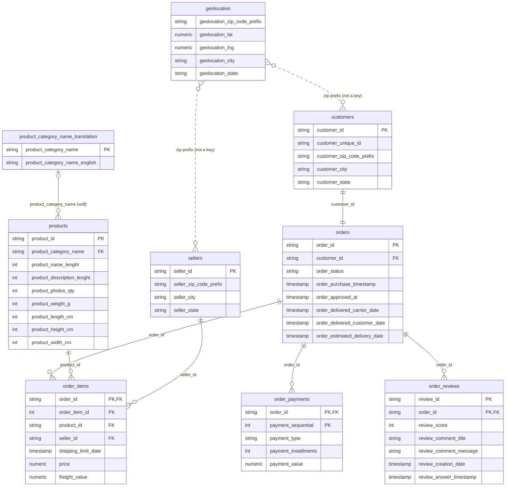

# Olist Dataset Relationships

Image version: [dataset_relationships.svg](dataset_relationships.svg)

## Notes (verified against the CSVs in this folder)

| Table | Rows |
|---|---|
| customers | 99,441 |
| orders | 99,441 |
| order_items | 112,650 |
| order_payments | 103,886 |
| order_reviews | 99,224 |
| products | 32,951 |
| sellers | 3,095 |
| geolocation | 1,000,163 |
| product_category_name_translation | 71 |

- **orders ↔ customers is 1 : 1.** Every order has its own `customer_id` (99,441 orders, 99,441 distinct IDs). Use `customer_unique_id` to identify real, repeat customers.
- **All order, customer, product, and seller links are complete** — 0 orphan foreign keys.
- **Not every order has children:** 775 orders have no items, 1 has no payment, 768 have no review.
- **Sellers connect to orders only through `order_items`;** one order can involve several sellers.
- **`review_id` is not unique on its own** (814 repeats); the key is `(review_id, order_id)`.
- **Category translation is a soft link:** 610 products have no category, and `pc_gamer` and `portateis_cozinha_e_preparadores_de_alimentos` (13 products) have no English translation. Use a LEFT JOIN.
- **Geolocation is not a key target:** zip prefixes repeat (19,015 distinct across ~1M rows), and 157 customer and 7 seller prefixes are missing. Aggregate to one row per prefix before joining.
- **Fan-out warning:** joining `orders` to two child tables at once (e.g. items and payments) multiplies rows and inflates sums. Aggregate each child table first.
