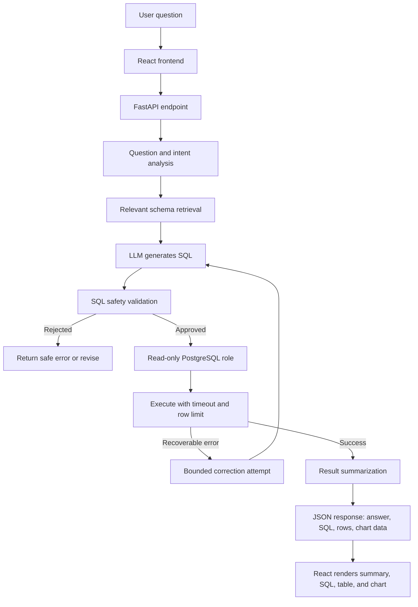

# Natural Language to SQL Analytics Agent

An intermediate-level Generative AI project that lets users ask business questions in plain English and receive SQL-backed answers, result tables, and optional visualizations. The agent uses an LLM to understand the question and draft SQL, but PostgreSQL executes the query and remains the source of truth.

The project has two parts: a **FastAPI backend** that runs the agent and a **React (JavaScript) frontend** where users ask questions and explore the results.

The project is designed around **real data**, using the public [Brazilian E-Commerce Public Dataset by Olist](https://www.kaggle.com/datasets/olistbr/brazilian-ecommerce).

## Table of Contents

- [Project Goals](#project-goals)
- [Features](#features)
- [Architecture](#architecture)
- [Technology Stack](#technology-stack)
- [Real Dataset](#real-dataset)
- [Example Questions](#example-questions)
- [How a Request Works](#how-a-request-works)
- [Security and Guardrails](#security-and-guardrails)
- [Proposed Project Structure](#proposed-project-structure)
- [Setup and Installation](#setup-and-installation)
- [Configuration](#configuration)
- [Implementation Roadmap](#implementation-roadmap)
- [Evaluation](#evaluation)
- [Limitations](#limitations)
- [Future Improvements](#future-improvements)

## Project Goals

Build a reliable natural-language analytics assistant that can:

1. Understand a user's business question.
2. identify the relevant PostgreSQL tables, columns, and relationships.
3. Generate SQL grounded in the actual database schema.
4. Validate the query before execution.
5. Execute approved, read-only SQL with sensible limits.
6. Explain the results in clear language and optionally produce a chart.
7. Handle ambiguous questions, invalid SQL, and insufficient data safely.

This is an analytics assistant, not an unrestricted database agent. It should not invent figures or claim that a query succeeded when it did not.

## Features

### Core features

- Natural-language-to-SQL generation.
- Schema-aware prompts using live database metadata.
- PostgreSQL integration.
- Read-only query execution.
- SQL validation and query timeouts.
- Bounded retries for recoverable SQL errors.
- Result summaries grounded in returned rows.
- Display the generated SQL so users can inspect it.
- Clear error messages when a request cannot be answered.

### Frontend features

- React web interface for asking questions in plain English.
- Conversation-style view of questions and answers.
- Generated SQL shown in a readable, copyable code block.
- Sortable, paginated result tables.
- Charts rendered from the backend's chart specification when the result set is suitable.
- Assumptions and clarification questions displayed alongside each answer.
- Loading, empty-result, and error states.
- CSV download of the returned rows.

### Intermediate-level extensions

- LangGraph workflow with explicit state and conditional edges.
- Clarification step for ambiguous business terms.
- Query explanation and assumptions.
- Charts for suitable result sets.
- Conversation history stored in PostgreSQL.
- Evaluation set with expected SQL results.
- Structured LLM output validated with Pydantic.
- Logging for latency, token usage, SQL failures, and retry counts.

## Architecture



### Important design principle

The LLM proposes a query; deterministic validation and database permissions decide what can run. Prompt instructions alone are not a security boundary.

## Technology Stack

| Component | Suggested technology | Purpose |
|---|---|---|
| Language | Python 3.11+ | Application and data pipeline |
| API | FastAPI | HTTP endpoints |
| Agent orchestration | LangGraph | Manage generation, validation, execution, and retry steps |
| LLM | A supported hosted or local model | Understand questions and draft SQL |
| Database | PostgreSQL | Store and query the dataset |
| SQL parsing | SQLGlot or equivalent parser | Parse and inspect SQL statements |
| Validation | Pydantic | Validate request and response schemas |
| Data loading | pandas and SQLAlchemy | Load CSV files into PostgreSQL |
| Testing | pytest | Unit, integration, and evaluation tests |
| Deployment | Docker | Reproducible local deployment |

### Frontend

| Component | Suggested technology | Purpose |
|---|---|---|
| Framework | React (JavaScript) | User interface |
| Build tool | Vite | Development server and production build |
| Runtime | Node.js (LTS) | Install packages and run the frontend tooling |
| Styling | Tailwind CSS | Layout and styling |
| Tables | TanStack Table | Sorting and pagination of result rows |
| Charts | Recharts | Render bar, line, and pie charts from the backend's chart specification |
| SQL display | react-syntax-highlighter | Highlight the generated SQL |
| HTTP | Fetch API | Call the FastAPI backend |
| Testing | Vitest and React Testing Library | Component and UI tests |

The backend returns a library-neutral chart specification (for example, chart type, x-axis column, and y-axis column), and the frontend decides how to draw it. This keeps the agent independent of any particular chart library.

Package APIs change over time. Pin compatible dependency versions in `requirements.txt` after choosing the LLM provider and LangGraph/LangChain versions.

## Real Dataset

### Brazilian E-Commerce Public Dataset by Olist

Dataset page: <https://www.kaggle.com/datasets/olistbr/brazilian-ecommerce>

The dataset contains real, anonymized e-commerce records from Brazil, including related CSV files for orders, customers, products, sellers, payments, reviews, and geolocation. The published data covers approximately 100,000 orders from 2016–2018.

**Before using the data**, review the dataset page and its current license and usage conditions. Do not attempt to identify individuals from anonymized records.

### Suggested tables

Use the source CSVs and preserve their original meaning. Common tables include:

- `orders`
- `order_items`
- `order_payments`
- `order_reviews`
- `customers`
- `products`
- `sellers`
- `geolocation`
- `product_category_translation`

Check the actual filenames, column names, data types, keys, and relationships in the downloaded release before defining your schema. The names above are logical table names, not a guarantee that every CSV has exactly those names.

### Data loading workflow

1. Download the dataset from its official hosting page.
2. Inspect each CSV and its columns.
3. Create PostgreSQL tables with appropriate data types and primary/foreign keys where valid.
4. Load the CSVs using a repeatable Python script.
5. Check row counts, nulls, duplicate keys, and relationships.
6. Record the schema and business definitions used by the agent.

Do not silently fabricate missing source records. If you create additional derived tables or metrics, document how they were calculated.

## Example Questions

The agent should answer only questions supported by the database schema and data.

- What were the monthly order counts over the available period?
- Which product categories had the highest number of orders?
- What is the total payment value by payment type?
- Which states have the most customers?
- What is the average review score by product category?
- How many orders were delivered later than their estimated delivery date?
- Which sellers have the highest order volume?
- How did order volume change month over month?

Metric definitions matter. For example, **order payment value is not automatically the same as recognized revenue**. The agent should use a documented definition and disclose assumptions.

## How a Request Works

1. **Receive the question.** Validate the request size and user access.
2. **Resolve ambiguity.** Ask a clarifying question if the requested metric or time period is unclear.
3. **Retrieve schema context.** Supply relevant table definitions, column types, keys, and documented metric definitions to the model.
4. **Generate SQL.** Request one SQL statement and structured output containing the query and assumptions.
5. **Validate SQL.** Parse the statement and reject disallowed operations, schemas, tables, or functions.
6. **Execute safely.** Use a least-privilege PostgreSQL account, a read-only transaction, statement timeout, and row limit.
7. **Recover carefully.** For a recoverable syntax or schema error, allow a small, bounded number of correction attempts. Never retry indefinitely.
8. **Summarize results.** Provide an explanation based on the actual query output. If no rows are returned, say so.
9. **Return inspectable output.** Include the SQL, column names, result rows, assumptions, and optional chart specification.

## Security and Guardrails

SQL generation must be treated as untrusted input.

- Use a dedicated PostgreSQL role with only the `SELECT` permissions it needs.
- Never connect using a database superuser or application-owner account.
- Allow only one parsed SQL statement per request.
- Allow only read-only query types; reject `INSERT`, `UPDATE`, `DELETE`, `DROP`, `ALTER`, `CREATE`, and other state-changing statements.
- Restrict accessible schemas, tables, columns, and sensitive fields.
- Apply a database-side statement timeout and a maximum returned-row limit.
- Set request timeouts and rate limits at the API layer.
- Do not interpolate user input into SQL strings.
- Do not expose database credentials, internal stack traces, or sensitive data in model prompts or logs.
- Avoid logging full query results or personal data by default.
- Validate generated SQL using a parser and enforce permissions at the database level. A keyword blacklist alone is insufficient.
- Treat database content as data, not as instructions to the LLM.
- Require authentication and authorization before exposing the service beyond local development.
- Restrict CORS to known frontend origins; do not use a wildcard origin outside local development.
- Never put LLM API keys, database credentials, or other secrets in frontend code or `VITE_*` variables — anything bundled into the frontend is public.
- Render summaries, SQL, and database values as plain text in React; do not use `dangerouslySetInnerHTML` for model or database output.

## Proposed Project Structure

```text
natural-language-sql-agent/
├── app/
│   ├── main.py                  # FastAPI application
│   ├── config.py                # Environment-based configuration
│   ├── api/
│   │   └── routes.py            # Analytics endpoints
│   ├── agent/
│   │   ├── graph.py             # LangGraph workflow
│   │   ├── state.py             # Workflow state schema
│   │   ├── prompts.py           # SQL-generation prompts
│   │   └── nodes.py             # Schema, generation, validation, execution nodes
│   ├── database/
│   │   ├── connection.py        # SQLAlchemy connection setup
│   │   ├── schema.py            # Database schema retrieval
│   │   └── executor.py          # Safe, read-only query execution
│   ├── services/
│   │   ├── sql_validator.py     # SQL parsing and policy checks
│   │   └── summarizer.py        # Result-grounded explanations
│   └── schemas/
│       └── requests.py          # Pydantic request/response models
├── scripts/
│   ├── create_tables.sql
│   └── load_olist_data.py
├── data/
│   └── README.md                # Instructions; keep downloaded data out of Git
├── tests/
│   ├── test_sql_validator.py
│   ├── test_api.py
│   └── test_evaluation.py
├── evaluation/
│   └── questions.json           # Evaluation questions and expected outcomes
├── frontend/                    # React (Vite) application
│   ├── src/
│   │   ├── main.jsx             # React entry point
│   │   ├── App.jsx              # Page layout
│   │   ├── api/
│   │   │   └── client.js        # Calls to the FastAPI backend
│   │   ├── components/
│   │   │   ├── QuestionInput.jsx
│   │   │   ├── AnswerCard.jsx   # Summary, assumptions, clarifications
│   │   │   ├── SqlViewer.jsx
│   │   │   ├── ResultsTable.jsx
│   │   │   └── ResultChart.jsx
│   │   └── hooks/
│   │       └── useAnalyticsQuery.js
│   ├── .env.example
│   ├── index.html
│   ├── package.json
│   ├── vite.config.js
│   └── Dockerfile
├── .env.example
├── .gitignore
├── requirements.txt
├── Dockerfile
├── compose.yaml
└── README.md
```

This is a proposed structure; implement it incrementally rather than creating every file upfront.

## Setup and Installation

### Prerequisites

- Python 3.11 or a compatible version supported by your selected dependencies.
- Node.js (current LTS) and npm for the React frontend.
- PostgreSQL.
- Git.
- An API key for your chosen LLM provider, or a locally hosted model.
- Access to the Olist dataset.

### 1. Clone the repository

```bash
git clone <your-repository-url>
cd natural-language-sql-agent
```

Replace `<your-repository-url>` with your repository URL after creating it.

### 2. Create and activate a virtual environment

Windows PowerShell:

```powershell
python -m venv .venv
.venv\Scripts\Activate.ps1
```

macOS/Linux:

```bash
python3 -m venv .venv
source .venv/bin/activate
```

### 3. Install dependencies

Create `requirements.txt` with the packages required by your implementation. A starting list is:

```text
fastapi
uvicorn[standard]
pydantic
pydantic-settings
sqlalchemy
psycopg[binary]
pandas
langgraph
langchain
sqlglot
python-dotenv
pytest
httpx
```

Add the integration package for your chosen LLM provider and pin tested versions before deployment.

```bash
pip install -r requirements.txt
```

### 4. Create the PostgreSQL database

Create a dedicated development database and a restricted application role. Keep credentials in environment variables rather than source code.

Example database name:

```text
nl_sql_analytics
```

Load the Olist CSVs into this database using the scripts you implement. Confirm the loaded row counts before using the agent.

### 5. Configure environment variables

Create `.env` based on `.env.example`. For example:

```dotenv
APP_ENV=development
DATABASE_URL=postgresql+psycopg://<readonly_user>:<password>@localhost:5432/nl_sql_analytics
LLM_PROVIDER=<your_provider>
LLM_MODEL=<your_model>
LLM_API_KEY=<your_api_key>
QUERY_TIMEOUT_SECONDS=10
MAX_ROWS=200
MAX_SQL_RETRIES=1
CORS_ALLOWED_ORIGINS=http://localhost:5173
```

These are configuration examples, not working credentials. Implement provider-specific configuration and ensure the database URL points to a genuinely restricted, read-only role.

Add `.env`, downloaded data files, local database dumps, and secrets to `.gitignore`.

### 6. Start the API

After implementing the FastAPI application and its configuration:

```bash
uvicorn app.main:app --reload
```

Open the interactive API documentation at:

<http://127.0.0.1:8000/docs>

The command will work once `app.main:app` has been implemented.

### 7. Start the React frontend

In a second terminal:

```bash
cd frontend
npm install
npm run dev
```

Create `frontend/.env` based on `frontend/.env.example`:

```dotenv
VITE_API_BASE_URL=http://127.0.0.1:8000
```

Open the app at:

<http://localhost:5173>

Only public, non-secret settings belong in `frontend/.env`. The backend must allow this origin through `CORS_ALLOWED_ORIGINS`.

## Suggested API Contract

### Request

`POST /analytics/query`

```json
{
  "question": "Which product categories have the highest order counts?"
}
```

### Example response shape

```json
{
  "question": "Which product categories have the highest order counts?",
  "sql": "SELECT ...",
  "columns": ["category", "order_count"],
  "rows": [],
  "summary": "The query returned no rows.",
  "assumptions": [],
  "chart": null
}
```

The SQL above is intentionally abbreviated and `rows` is empty to illustrate the response structure only. Real responses must contain the actual query and database results; the application must never return illustrative values as if they came from the database.

## Implementation Roadmap

### Phase 1 — Data and database

- Download and inspect the real Olist dataset.
- Create relational PostgreSQL tables.
- Load data and verify data quality.
- Document table relationships and key business definitions.

### Phase 2 — Basic text-to-SQL

- Build a FastAPI endpoint.
- Retrieve relevant schema metadata.
- Prompt the LLM to generate SQL.
- Execute a small set of manually verified read-only queries.
- Return the SQL and result rows.

### Phase 3 — Validation and recovery

- Add SQL parsing and policy checks.
- Use a read-only database role and statement timeout.
- Add bounded retries for recoverable errors.
- Ask clarifying questions when the request is ambiguous.

### Phase 4 — LangGraph orchestration

- Define workflow state with Pydantic or typed structures.
- Add nodes for question analysis, schema retrieval, SQL generation, validation, execution, correction, and summarization.
- Use conditional edges for rejected queries and recoverable failures.
- Set iteration limits and handle terminal failures.

### Phase 5 — React frontend

- Scaffold the React app with Vite.
- Build the question input and answer view against the `POST /analytics/query` contract.
- Display generated SQL, result tables, assumptions, and clarification questions.
- Render charts from the backend's chart specification only when appropriate for the returned data.
- Handle loading, empty, and error states; add CSV download.
- Configure CORS on the backend for the frontend origin.

### Phase 6 — Evaluation and presentation

- Create a set of representative questions and independently verified expected outcomes.
- Measure execution accuracy, result correctness, invalid-query rejection, latency, and token cost.
- Document limitations and deploy the backend, frontend, and PostgreSQL with Docker Compose.

## Evaluation

Do not evaluate the project only by whether the SQL executes. A syntactically valid query can still answer the wrong question.

Track:

- **Execution accuracy:** Does the query run successfully?
- **Result correctness:** Does it return the expected answer on the fixed dataset?
- **Semantic correctness:** Does it calculate the intended metric and use the correct joins and filters?
- **Safety:** Are destructive and unauthorized queries rejected?
- **Clarification quality:** Does the agent ask questions when definitions are ambiguous?
- **Grounded summaries:** Does the explanation match the query results?
- **Performance:** End-to-end latency, token usage, retries, and database execution time.

Store evaluation questions and expected outputs separately from the implementation. Verify expected results using independently written SQL or manual checks rather than using the same LLM to grade itself.

## Limitations

- The Olist dataset represents a particular historical Brazilian e-commerce context, not all industries.
- The agent cannot answer questions about fields or facts that are not present in the database.
- Ambiguous business terms can produce incorrect metrics unless definitions are documented.
- LLM-generated SQL may be wrong even when it passes syntax checks.
- Data quality issues in the source can affect analytical results.
- Hosted LLMs may incur usage charges; review current pricing and provider data-handling policies before sending schema or query context.

## Future Improvements

- Add support for multiple databases with explicit per-database permissions.
- Add semantic metadata for business terms and metric definitions.
- Add schema-aware retrieval for large databases.
- Add query-plan inspection and cost limits.
- Add role-based access controls and audit trails.
- Add caching for repeated safe queries.
- Add streaming responses so the frontend can show agent progress step by step.
- Add saved questions and shareable result links in the frontend.
- Add a comparison between different LLMs using the same evaluation suite.

## License and Data Attribution

This repository's code license should be selected separately. Review the Olist dataset's current license and terms on its hosting page and include appropriate attribution. Do not assume the dataset license automatically applies to your code or to other third-party materials.

---

**Project principle:** Let the LLM interpret the question and propose SQL; let the database, deterministic validation, and measured evaluation establish what is safe and correct.
